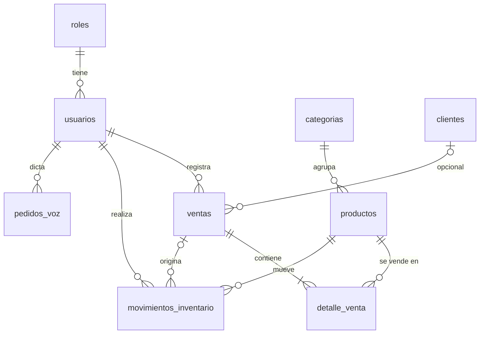

# Arquitectura

## Tres capas
```
Navegador (React + Web Speech API)  ──HTTP/JSON──▶  API Express  ──SQL parametrizado──▶  PostgreSQL
 presentación, STT/TTS                              reglas de negocio, seguridad          datos y restricciones
```
- **Presentación** (`frontend/`): páginas, componentes, hooks de voz. Nunca accede a la BD.
- **Lógica** (`backend/src`): `routes` (permisos y validación) → `controllers` (HTTP) → `services` (reglas de negocio y SQL). El intérprete de voz es **puro** (`services/voz/`), sin acceso a BD, por lo que se prueba de forma aislada.
- **Datos** (`database/schema.sql`): restricciones CHECK/UNIQUE/FK y transacciones; lo crítico (stock ≥ 0, montos ≥ 0) se garantiza también en la BD.

## Modelo de datos
8 entidades pedidas + 2 auxiliares justificadas:


- `detalle_venta` guarda **nombre y precio unitario históricos**: cambiar un precio no altera ventas pasadas.
- `ventas.tasa_impuesto` guarda la tasa vigente al vender. `ventas.clave_idempotencia` (índice único parcial por usuario) evita duplicar ventas ante reintentos.
- Auxiliares: `configuracion_negocio` (fila única: impuesto, umbral y margen de similitud, caducidad) y `pedidos_voz` (pedido pendiente de confirmar, con caducidad).

## Flujo de una venta por voz
```mermaid
sequenceDiagram
  participant U as Vendedor
  participant F as Frontend
  participant A as API
  participant D as PostgreSQL
  U->>F: "Vender dos Coca-Cola" (micrófono)
  F->>F: Web Speech API → texto
  F->>A: POST /voz/interpretar {texto}
  A->>D: productos activos + configuración
  A->>A: normalizar, cantidades, coincidencia aproximada
  A->>D: guarda pedido PENDIENTE (sin tocar inventario)
  A-->>F: renglones + estados (ok / ambiguo / no_encontrado / sin_stock) + frase a leer
  F-->>U: muestra y LEE el resumen, pide confirmar
  U->>F: "Confirmar la venta" (o botón)
  F->>A: POST /voz/pedidos/:id/confirmar
  A->>D: BEGIN; bloquea pedido y productos (FOR UPDATE); revalida; inserta venta, detalle y movimientos; actualiza stock; COMMIT
  A-->>F: venta registrada
```
Reglas: sin confirmación no hay venta; un pedido cancelado o caducado no genera movimientos; confirmar dos veces devuelve la misma venta; si el stock cambió entre dictar y confirmar, se rechaza sin descontar nada y el pedido sigue editable.

## Coincidencia aproximada (resumen)
1. **Normalizar**: minúsculas, sin tildes ni signos, sin muletillas («por favor», «quiero»…), plural simple, pliegue fonético (`k/c/qu → k`, `v → b`, `z/ce/ci → s`, `h` muda, `ll → y`, letras dobles).
2. **Cantidades**: dígitos y palabras hasta 100 («treinta y cinco»), «media docena»; «500 ml» no se toma como cantidad.
3. **Puntaje** (0–1) entre lo dicho y cada producto = 0.5·similitud de frase completa + 0.3·similitud por palabras + 0.2·cobertura, con un piso para nombres contenidos («arroz» ⊂ «Arroz Flor»), usando distancia de Levenshtein.
4. **Decisión** con parámetros configurables: bajo el `umbral_similitud` → *no encontrado* (con sugerencias); si dos o más candidatos quedan a menos de `margen_ambiguedad` → *ambiguo* y se piden opciones; si no, *ok*. Una coincidencia exacta única se acepta.

## Seguridad
JWT firmado (`sub` = id, expira en 8 h por defecto) + **recarga del usuario en cada petición**; roles verificados en middleware; zod valida cuerpos, parámetros y filtros; SQL siempre parametrizado (las únicas interpolaciones son números enteros ya validados y la zona horaria, saneada); `helmet`, CORS por lista blanca, límite de cuerpo de 100 kB, límite de intentos de login; respuestas de error genéricas; CSV con protección contra inyección de fórmulas.
